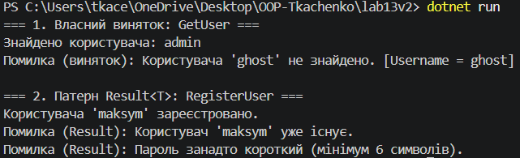

# Звіт з лабораторної роботи №13

**З дисципліни:** Об'єктно-орієнтоване програмування
**Тема:** Власні винятки та патерн Result.
**Виконав:** студент Ткаченко Максим **Варіант:** №2

---

## 1. Мета роботи

Навчитися створювати власні типи винятків для специфічних помилок, а також реалізовувати патерн `Result` для більш контрольованої обробки помилок без використання винятків у "нормальних" сценаріях невдачі.

---

## 2. Індивідуальне завдання (Варіант 2)

Реалізувати управління користувачами з використанням власних винятків та патерну `Result`.

* **Власний виняток:** `UserNotFoundException` (властивість `Username`).
* **Service:** `UserService` з методами `GetUser` та `RegisterUser`.
* **Демонстрація:** Метод `GetUser` викидає `UserNotFoundException`, якщо користувача не знайдено. Метод `RegisterUser` повертає `Result.Success` або `Result.Failure` (якщо ім'я вже існує або пароль закороткий).

---

## 3. Структура проєкту

* `lab13v2/User.cs` — record-клас, що описує сутність користувача (ім'я та пароль).
* `lab13v2/Result.cs` — узагальнений клас `Result<T>` з властивостями `IsSuccess`, `Value`, `Error` та статичними фабричними методами.
* `lab13v2/UserNotFoundException.cs` — власний клас винятку, успадкований від `Exception`, зі стандартними конструкторами.
* `lab13v2/UserService.cs` — клас-сервіс із бізнес-логікою (методи `GetUser` і `RegisterUser`).
* `lab13v2/Program.cs` — головний файл із точкою входу `Main`, де демонструється обробка результатів та винятків.
* `.gitignore` — конфігураційний файл для виключення системних та тимчасових файлів .NET.

---

## 4. Результати виконання програми

Після запуску програми за допомогою команди `dotnet run` у терміналі отримано такий вивід:

```text
=== 1. Власний виняток: GetUser ===
Знайдено користувача: admin
Помилка (виняток): Користувача 'ghost' не знайдено. [Username = ghost]

=== 2. Патерн Result<T>: RegisterUser ===
Користувача 'maksym' зареєстровано.
Помилка (Result): Користувач 'maksym' уже існує.
Помилка (Result): Пароль занадто короткий (мінімум 6 символів).
```

### Скріншот виконання програми


---

## 5. Висновок

У роботі продемонстровано два підходи. **Власний виняток** (`UserNotFoundException`) зручно використовувати для виняткових, непередбачуваних ситуацій (порушення контракту методу). **Патерн `Result<T>`** краще підходить для валідації та очікуваних "невдач" у бізнес-логіці (наприклад, невалідні дані при реєстрації), оскільки це нормальний потік програми, який змушує розробника явно обробляти результат і не вимагає ресурсоємного створення об'єктів винятків.
